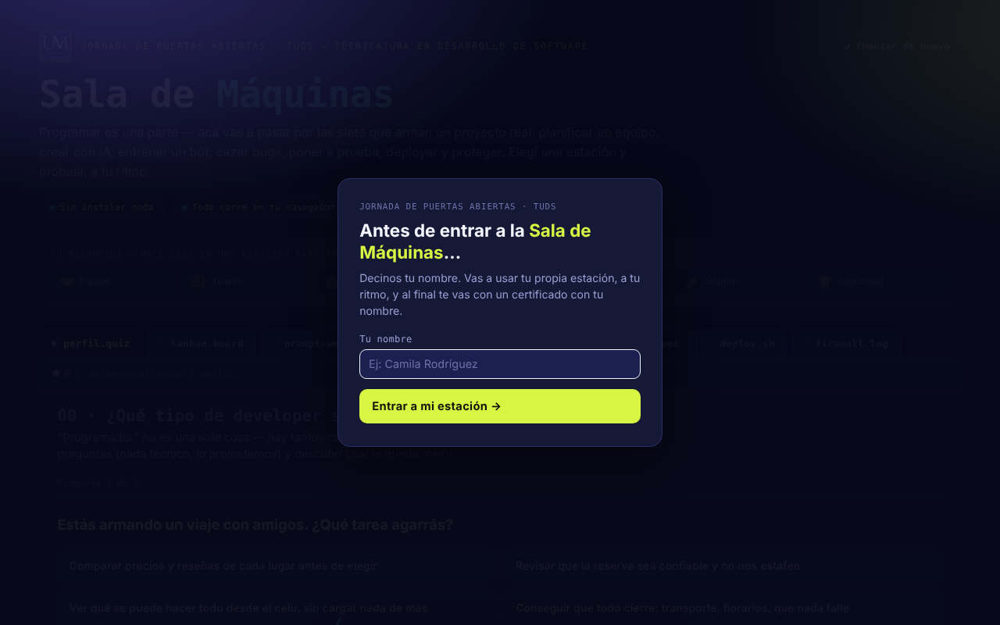

# 🛠️ Sala de Máquinas — Open House TUDS 2026

> Interactive, station-based activity for the Software Development program's open house at Universidad de Mendoza (Río Cuarto): visitors play through the software lifecycle and get a personalized certificate.

     



## Overview
Visitors enter their name and walk through stations covering what a software team actually does: quiz, kanban board, AI, finding bugs, **QA**, deployment and security — ending with a certificate in their name.

## Key features
- **Name gate** that personalizes the whole experience and the final certificate.
- **Stateless by design**: everything runs in the visitor's browser (`localStorage`), so dozens of simultaneous users need no database.
- **"Start over" reset** so the next visitor on a shared computer starts from scratch.
- Mobile-friendly layout.

## Architecture
A minimal **Node.js + Express** server (`server.js`) serving `public/index.html`, deployed on **Railway** (`railway.json`).

## Run locally
```bash
npm install
npm start          # http://localhost:3000
```

---

## Author

**Guillermo Cuenya** — Senior QA Automation Engineer / SDET · Telecommunications Engineer  
[LinkedIn](https://www.linkedin.com/in/guillermoadriancuenya/) · [GitHub](https://github.com/gcuenya1)
